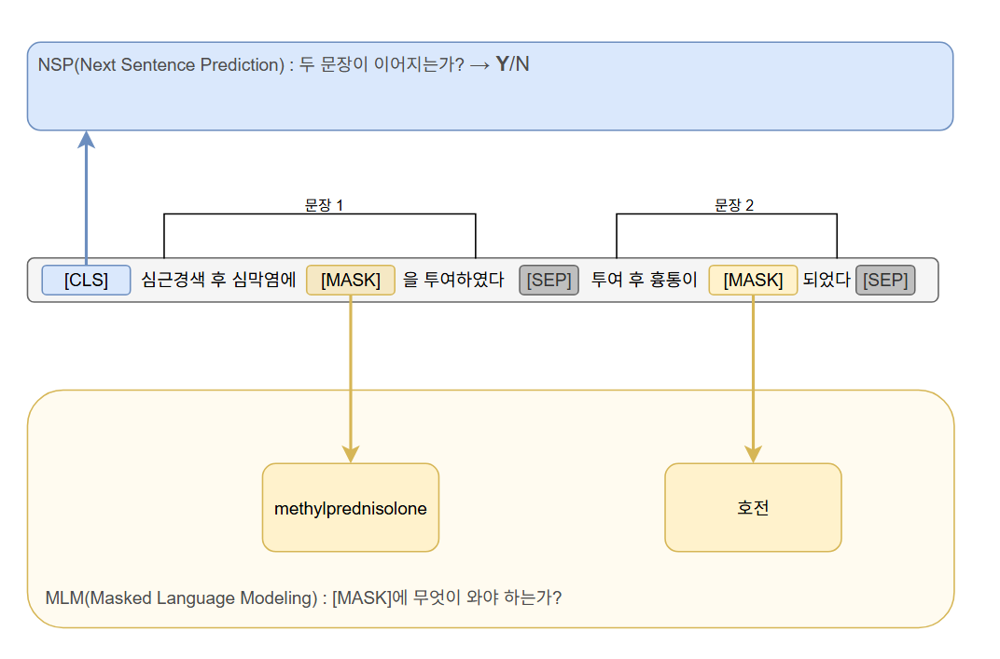
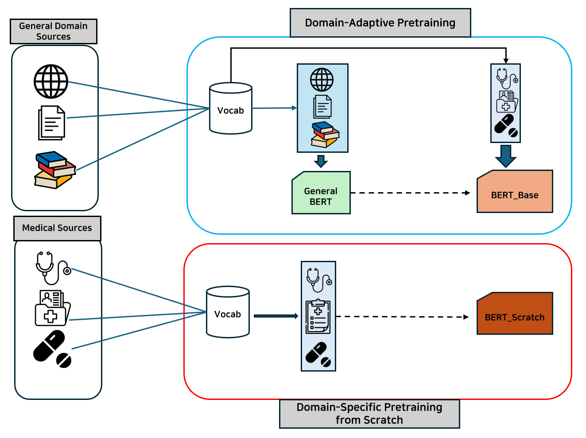
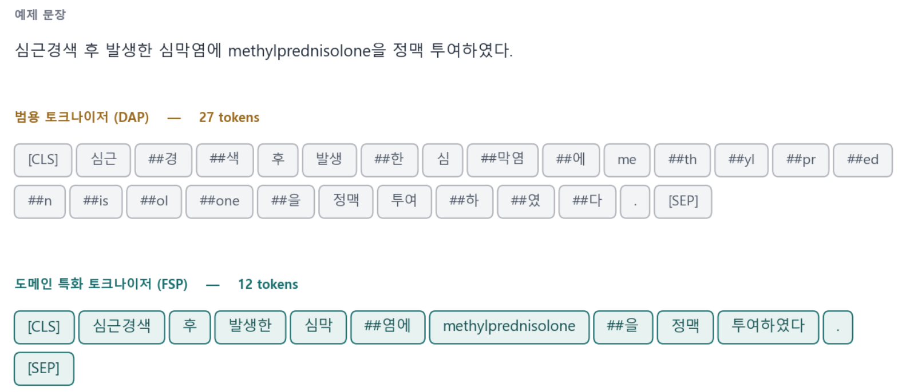
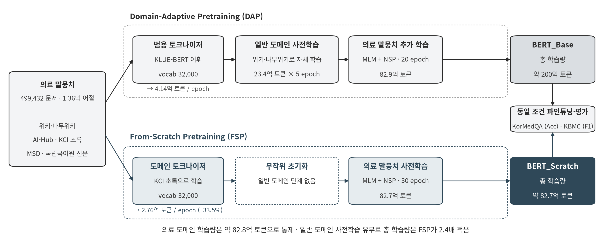
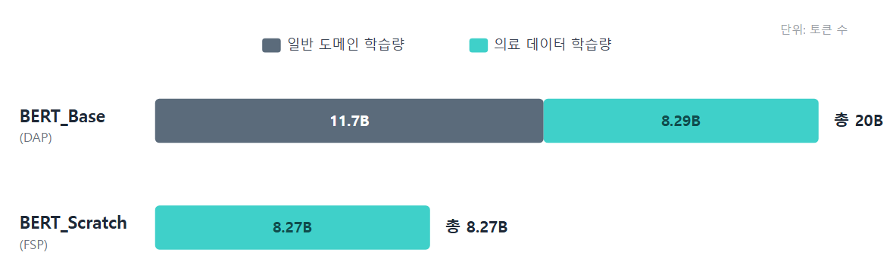
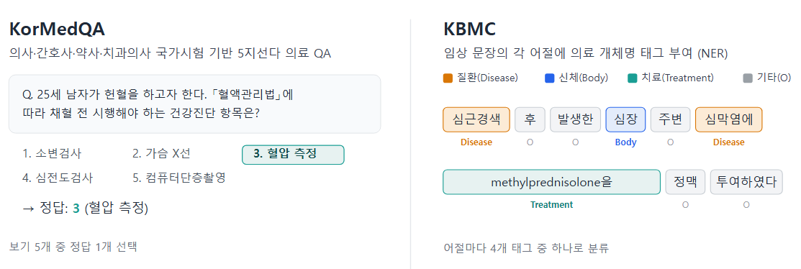
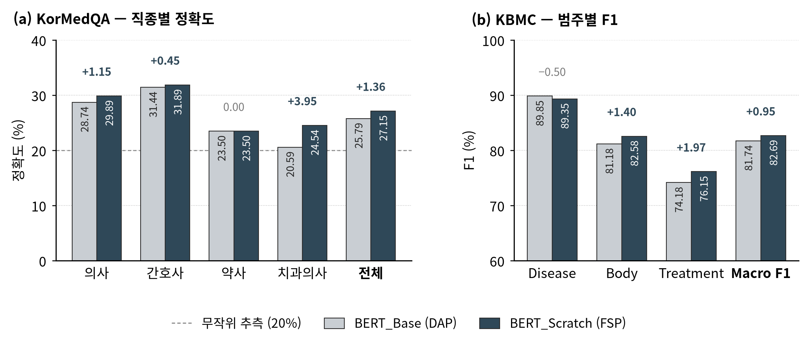

# 한국어 임상 NLP를 위한 사전학습 전략 비교: Domain-Adaptive vs From-Scratch

> 한국어 의료 말뭉치만으로 BERT를 처음부터 사전학습했다. 이 모델은 일반 도메인 BERT에 같은 의료 말뭉치를 추가 학습시킨 모델보다 총 학습량이 2.4배 적은데도, 두 다운스트림 과제에서 모두 앞섰다.


**언어 / Language: 한국어 (아래) · [English](#english)**

> 논문: [BERT Models for Korean Clinical NLP: Comparing Domain-Adaptive Pretraining and From-Scratch Pretraining Approaches](BERT_Models_for_Korean_Clinical_NLP_Comparing_Domain_Adaptive_Pretraining_and_From_Scratch_Pretraining_admin.pdf)<br>
> 발표 자료: [`26춘계_자유연제04.pdf`](26춘계_자유연제04.pdf) — 2026년 춘계학술대회 자유연제 4 (학부생 발표 세션 I)

---

## 소개

BERT 같은 사전학습 언어모델을 의료 도메인에 적용하는 방법은 크게 두 가지다. 하나는 Domain-Adaptive Pretraining(DAP)으로, 일반 도메인에서 이미 학습된 BERT를 가져와 의료 말뭉치로 추가 학습시킨다. BioBERT가 이렇게 만들어졌고, 한국어 의료 모델인 KM-BERT도 같은 방식이다. 다른 하나는 From-Scratch Pretraining(FSP)으로, 일반 도메인을 거치지 않고 의료 텍스트만으로 어휘집부터 모델 가중치까지 처음부터 학습한다. PubMedBERT가 대표적이고, 영어권에서는 도메인 텍스트가 충분하면 FSP가 DAP보다 낫다는 결과가 이미 나와 있다.

한국어 의료 도메인에는 FSP로 만든 모델이 아직 없었다. 영어권의 PubMed나 MIMIC처럼 대규모로 공개된 한국어 임상 텍스트가 없어서, 처음부터 학습할 만한 재료를 구하기가 어려웠기 때문이다. 그렇다고 DAP로 충분한 것도 아니다. 한국어는 교착어라 같은 단어도 조사와 어미에 따라 형태가 달라지는데, 여기에 범용 토크나이저가 의학 용어를 잘게 쪼개는 문제까지 겹친다. 예를 들어 KLUE-BERT의 범용 토크나이저는 `methylprednisolone`을 아홉 조각으로, `심근경색`을 세 조각으로 나눈다. DAP는 이 토크나이저를 그대로 물려받기 때문에 의료 말뭉치를 아무리 더 학습시켜도 이 문제가 남는다.

그래서 이 연구에서는 한국어 의료 FSP 모델을 직접 만들고, DAP 모델과 같은 조건에서 비교했다.

- 위키피디아·나무위키, AI-Hub, KCI 논문 초록, MSD 매뉴얼, 국립국어원 신문 말뭉치의 다섯 출처에서 의료 말뭉치 499,432문서(1.36억 어절)를 모았다.
- KCI 의학·약학 초록만으로 도메인 토크나이저를 학습했다. 영문 약물명·질환명이 밀도 높게 들어 있어 한국어와 영문 의학 용어를 한 어휘집에 담을 수 있기 때문이다. 이 토크나이저는 같은 말뭉치를 범용 토크나이저보다 33.5% 적은 토큰으로 쪼갠다.
- 이 말뭉치로 두 모델을 사전학습했다. `BERT_Base`(DAP)는 일반 도메인에서 미리 학습해 둔 BERT에서 출발해 의료 말뭉치를 20 epoch 더 학습했고, `BERT_Scratch`(FSP)는 랜덤 초기화에서 출발해 30 epoch 학습했다. 토크나이저가 다르면 같은 말뭉치에서 나오는 토큰 수도 다르므로, epoch을 달리 두어 두 모델이 보는 의료 도메인 토큰을 약 82.8억(82.9억 대 82.7억)으로 맞췄다.
- 두 모델을 같은 설정으로 파인튜닝해 KorMedQA(의료 국가시험 5지선다)와 KBMC(임상 개체명 인식)에서 평가했다.

`BERT_Base`는 의료 말뭉치를 보기 전에 이미 일반 도메인에서 117억 토큰을 학습한 상태라, 총 학습량은 `BERT_Base`가 약 200억 토큰, `BERT_Scratch`가 약 82.7억 토큰으로 2.4배 차이가 난다. 그런데도 `BERT_Scratch`가 KorMedQA에서 1.36%p, KBMC에서 0.95%p 더 높았고, 영문 약물명·시술명이 많이 나오는 KBMC의 Treatment 범주에서 차이가 가장 컸다. 도메인 토크나이저가 의학 용어를 하나의 단위로 다루고, 그 어휘에 맞춰 가중치를 처음부터 학습한 효과로 본다.

이 결과는 두 가지를 보여준다. 첫째, 대규모 임상 말뭉치가 없어도 공개 자료를 모은 1.36억 어절 규모의 말뭉치로 한국어 의료 FSP 모델을 만들 수 있고, 그 모델이 DAP 모델을 넘어설 수 있다. 둘째, 한국어 의료 모델을 만들 때는 모델 크기나 학습량보다 토크나이저를 먼저 봐야 한다. 범용 어휘집을 물려받은 채 의료 말뭉치를 더 학습하는 것보다, 어휘를 도메인 텍스트로 새로 만들고 가중치를 그 어휘에 맞춰 처음부터 학습하는 쪽이 의학 용어를 의미 단위로 유지했고, 그 차이가 다운스트림 결과로 이어졌다. 이 연구는 그동안 보고된 적 없던 한국어 의료 FSP 모델을 공개 자료만으로 구현해 학습부터 평가까지 돌렸고, 임상 말뭉치가 부족한 한국어 의료 도메인에서도 FSP가 유효한 선택지라는 것을 보였다. K-MIMIC 같은 대규모 한국어 임상 데이터가 공개되면 같은 방법을 순수 임상 텍스트에 그대로 적용할 수 있다.

이 저장소에는 그 과정 전체를 실행 순서대로 정리했다. 말뭉치 수집(`1.corpus`), 전처리와 토크나이저 학습(`2.preprocessing`), 사전학습(`3.pretraining`), 파인튜닝(`4.finetuning`), 평가(`5.evaluation`)의 다섯 단계로 나누었고, 단계마다 코드와 실행 로그, 최종 지표를 넣었다. 말뭉치 원문과 모델 가중치, 토크나이저 어휘집은 저작권과 용량 문제로 넣지 않았다. 대신 코드와 실행 로그를 남겨, 산출물은 다시 만들고 논문의 수치는 원천 데이터 없이도 확인할 수 있게 했다.

---

## 1. 배경

### 1.1 BERT의 사전학습



*그림 1. BERT의 두 사전학습 과제. 예문은 이 연구의 토크나이저 비교에 쓴 문장으로, 의학 검수를 거쳤고 실제 분절 결과는 그림 3에 있다.*

BERT는 라벨이 없는 대량의 텍스트로 두 가지 과제를 동시에 학습한다. MLM(Masked Language Modeling)은 입력 토큰의 일부를 `[MASK]`로 가린 뒤 원래 토큰이 무엇이었는지 맞히는 과제이고, NSP(Next Sentence Prediction)는 `[SEP]`로 나뉜 두 문장이 실제로 이어지는지 판별하는 과제다. 그림 1의 예에서는 "심근경색 후 심막염에 `[MASK]`을 투여하였다"의 빈칸에 `methylprednisolone`을, "투여 후 흉통이 `[MASK]`되었다"의 빈칸에 `호전`을 채우고, 두 문장이 이어지는지도 함께 판단한다. 이 저장소의 두 모델 모두 이 두 과제로 사전학습했다.

### 1.2 Domain-Adaptive Pretraining과 From-Scratch Pretraining



*그림 2. 두 사전학습 전략. 어떤 말뭉치로 어휘집을 만들고 어디서 학습을 시작하느냐가 다르다.*

그림 2의 위쪽 경로가 DAP다. 위키피디아나 책 같은 일반 도메인 텍스트로 어휘집을 만들고, 그 어휘집으로 General BERT를 학습한 다음, 거기에 의료 말뭉치를 추가로 학습시켜 `BERT_Base`를 얻는다. 이미 만들어진 일반 BERT의 가중치와 어휘를 그대로 물려받아 의료 쪽으로 적응시키는 방식이다.

아래쪽 경로가 FSP다. 일반 도메인 단계를 거치지 않고, 의료 텍스트만으로 어휘집을 새로 만든 뒤 그 위에서 모델을 처음부터 학습해 `BERT_Scratch`를 얻는다. General BERT 단계가 아예 없다는 점이 DAP와 결정적으로 다르다.

두 방식은 결국 어휘집에서 갈린다. DAP는 일반 도메인 말뭉치에서 어휘를 가져오기 때문에 상대적으로 드문 의학 용어를 충분히 담지 못하고, 그 결과 전문 용어가 의미 없는 조각으로 잘게 쪼개진다. FSP는 의료 말뭉치로 어휘를 만들기 때문에 같은 용어를 하나의 의미 단위로 인식한다. 말뭉치의 차이가 어휘의 차이로 이어지고, 그것이 의학 용어 처리에 그대로 영향을 준다. 그래서 의료 텍스트가 충분한 도메인이라면, 어휘와 가중치를 모두 도메인에 맞춰 새로 학습하는 FSP가 더 유리할 수 있다.

### 1.3 선행 연구

**BioBERT** (Bioinformatics 2020) — DAP. 범용 도메인(English Wikipedia + BooksCorpus)으로 사전학습한 BERT를 생의학 말뭉치(PubMed 초록 45억 단어 + PMC 전문 135억 단어)로 추가 학습시켰다. 기존 BERT의 범용 WordPiece 어휘를 그대로 물려받았으므로 토크나이저는 일반 도메인의 것 그대로다.

**PubMedBERT** (ACM Trans. Comput. Healthcare 2021) — FSP. 범용 도메인 사전학습 없이 생의학 말뭉치(PubMed 초록 약 1,400만 건, 31억 단어)만으로 어휘와 가중치를 처음부터 학습했다. 전용 어휘를 직접 만들어 `naloxone`, `lidocaine` 같은 용어를 조각내지 않고 한 단위로 보존한다. 도메인 텍스트가 충분하면 처음부터 학습하는 쪽이 일반 모델의 추가 학습보다 낫다는 것을 다운스트림 태스크에서 보였다.

**KM-BERT** (Scientific Reports 2022) — DAP. 일반 도메인에서 학습된 KR-BERT를 한국어 의료 말뭉치(의학 교과서·건강정보 뉴스·의학 논문, 약 1.16억 단어)로 추가 학습시켰다. 토크나이저를 그대로 썼기 때문에 의학 용어 과분절이 남아 있다(`ibuprofen` → `i` / `##bu` / `##pro` / `##fen`). 희소 단어 문제를 풀기 위해 의학 용어 10,562개를 어휘집에 추가한 KM-BERT-vocab도 만들었지만 성능은 나아지지 않았고, 처음부터 사전학습하면 더 유의미한 결과를 기대할 수 있다고 적었다.

| | Domain-Adaptive Pretraining (DAP) | From-Scratch Pretraining (FSP) |
|---|---|---|
| 영어-의료 도메인 | BioBERT | PubMedBERT |
| 한국어-의료 도메인 | KM-BERT | **이 연구** |

세 연구를 정리하면 다음과 같다.

- **DAP의 한계.** 일반 도메인으로 사전학습한 BERT는 의료 말뭉치를 추가 학습시켜도 일반 도메인에 맞춰진 출발점을 완전히 벗어나기 어렵다 [2]. 어휘만 추가해서는 나아지지 않을 수 있다 [3].
- **FSP의 차별점.** 토크나이저와 임베딩을 도메인에 맞춰 한 번에 최적화하고, 다운스트림 태스크에서 DAP를 넘어섰다 [2].
- **연구 공백.** 한국어 의료 도메인에서 FSP를 구축한 사례는 아직 보고된 바 없다.

---

## 2. 사전학습

### 2.1 데이터셋 구성

사전학습 말뭉치는 다섯 출처에서 모았다. 출처마다 성격이 달라 수집 방식도 달리했다. 위키피디아·나무위키의 의학·약학 문서는 덤프에서 뽑았고, AI-Hub 의학지식 데이터는 이용 신청을 거쳐 내려받았다. KCI 의학·약학 저널 초록은 공식 API(OAI-PMH)로 수집했고, MSD 매뉴얼은 웹에서 크롤링했으며, 국립국어원 신문 말뭉치의 건강·미용 섹션은 배포 자료를 그대로 썼다. MSD 매뉴얼은 질환·약물·진단 정보를 담은 표준 의학 레퍼런스로, 전문가용과 일반인용이 따로 나온다.

| 출처 | 수집 방식 | 산출 파일 | 문서 수 | 어절 수 |
|---|---|---|---:|---:|
| 위키피디아 · 나무위키 (의학/약학 문서) | 덤프 | `merged_wiki.txt` | 21,025 | 3,576,818 |
| AI-Hub 의학지식 데이터 | 공개 데이터 | `merged_book.txt` | 14,163 | 8,115,949 |
| KCI 의학·약학 초록 (학술지) | 공식 API | `kci_records_arti.jsonl` | 42,215 | 5,855,588 |
| KCI 의학·약학 초록 (학술지 + 학술대회) | 공식 API | `kci_records_arti_conf.jsonl` | 42,215 | 5,855,588 |
| MSD 매뉴얼 | 웹 크롤링 | `corpus_sentences.txt` | 3,399 | 1,971,990 |
| 국립국어원 신문 말뭉치 (건강·미용) | 배포 자료 | `news_medical_corpus.txt` | 376,415 | 110,839,624 |
| **합계** | | 6개 파일 | **499,432** | **136,215,557** |

표의 수치는 [`1.corpus/logs/log_status.txt`](1.corpus/logs/log_status.txt)의 값이며, [`1.corpus/99.status.py`](1.corpus/99.status.py)를 실행하면 다시 계산할 수 있다.

### 2.2 토크나이저 구성

범용 쪽(DAP)은 한국어 일반 도메인으로 학습된 KLUE-BERT의 토크나이저를 그대로 썼고, 도메인 쪽(FSP)은 KCI 의학·약학 초록으로 직접 학습했다. KCI 초록을 고른 것은 임상에서 실제로 쓰는 영문 약물명·질환명이 밀도 높게 들어 있어서, 한국어와 영문 의학 용어를 한 어휘집에 함께 담을 수 있기 때문이다.



*그림 3. 같은 문장을 두 토크나이저에 실제로 넣어 얻은 결과. 범용 27토큰, 도메인 특화 12토큰.*

"심근경색 후 발생한 심막염에 methylprednisolone을 정맥 투여하였다"라는 한 문장을 범용 토크나이저는 27토큰으로, 도메인 토크나이저는 12토큰으로 쪼갠다. `methylprednisolone`은 범용에서는 `me`, `##th`, `##yl`처럼 아홉 조각으로 쪼개지지만 도메인에서는 한 토큰으로 남고, `심근경색`도 범용에서는 세 조각, 도메인에서는 한 토큰이라 의미 단위가 그대로 유지된다.

말뭉치 전체로 보면 도메인 토크나이저의 토큰 수가 범용보다 33.5% 적다. 토큰 수가 이만큼 다르므로, 두 모델을 공정하게 비교하려면 학습 epoch을 달리 두어야 한다(2.3절).

| | 범용 토크나이저 (DAP) | 도메인 특화 토크나이저 (FSP) |
|---|---|---|
| 학습 데이터 | 일반 도메인 (KLUE-BERT 어휘) | KCI 의학·약학 초록 |
| 어휘 크기 | 32,000 | 32,000 |
| 말뭉치 분절 결과 (1 epoch) | 414,489,110 토큰 | 275,818,284 토큰 (−33.5%) |

두 어휘집이 공유하는 토큰은 12,223개다([`2.preprocessing/logs/log_inspect.txt`](2.preprocessing/logs/log_inspect.txt)). 토크나이저 학습 코드는 [`2.preprocessing/1.pretrain_data/3.build_dataset_scratch.py`](2.preprocessing/1.pretrain_data/3.build_dataset_scratch.py)의 `train_tokenizer()`에 있고, 분절량은 [`5.count_tokens.py`](2.preprocessing/1.pretrain_data/5.count_tokens.py)로 측정해 [`log_count_tokens.txt`](2.preprocessing/logs/log_count_tokens.txt)에 남겼다. 용어·문장 단위의 비교는 [`5.evaluation/logs/log_compare_tokenizers.txt`](5.evaluation/logs/log_compare_tokenizers.txt)에 더 있다.

### 2.3 실험 설계

두 모델 모두 같은 BERT-base 구조(12 layers, 768 hidden, 12 heads)이고 MLM과 NSP로 사전학습하며, 출발점만 다르다. `BERT_Base`는 일반 도메인 가중치에서 출발해 의료 말뭉치를 추가 학습하는 DAP이고, `BERT_Scratch`는 일반 도메인 없이 의료 말뭉치만으로 처음부터 학습하는 FSP다.

공정한 비교를 위해 두 모델이 보는 의료 도메인 토큰을 약 82.8억으로 맞췄다. 토크나이저마다 같은 말뭉치에서 나오는 토큰 수가 다르므로 epoch을 20과 30으로 달리 두었고, 그 결과 의료 도메인 학습량은 82.9억 대 82.7억으로 거의 같다. learning rate 등 나머지 조건도 같다.

| 항목 | BERT_Base (DAP) | BERT_Scratch (FSP) |
|---|---|---|
| 초기 가중치 | 일반 도메인 사전학습 모델 | 랜덤 초기화 |
| 토크나이저 | KLUE-BERT | KCI 초록 학습 |
| Epochs | 20 | 30 |
| 의료 도메인 학습량 | 8.29B 토큰 | 8.27B 토큰 |
| Learning rate | 1e-4 | 1e-4 |
| 코드 | [`3.pretraining/1.dap/`](3.pretraining/1.dap/) | [`3.pretraining/2.scratch/`](3.pretraining/2.scratch/) |

**사전학습 하이퍼파라미터** (두 모델 동일)

| 항목 | 값 | 항목 | 값 |
|---|---|---|---|
| 학습 과제 | MLM (15%) + NSP | Learning rate | 1e-4 |
| Max sequence length | 512 | Batch size | 32 × grad accum 4 |
| Target segment length | 250 | Warmup ratio | 0.1 |
| Validation size | 10,000 | Seed | 42 |



*그림 4. 공통 말뭉치에서 갈라지는 두 경로. 의료 도메인 학습량은 같고, 일반 도메인 사전학습의 유무만 다르다.*

다만 표의 초기 가중치를 보면 DAP는 일반 도메인 사전학습을 먼저 거친다. 이 차이가 실제로 얼마나 큰지는 다음 절에서 다룬다.

### 2.4 총 학습 토큰 수



*그림 5. 의료 도메인 학습량(민트색)은 두 모델이 거의 같지만, `BERT_Base`는 그 앞에 일반 도메인 학습량(회색) 117억 토큰이 더 있다.*

의료 도메인 학습량은 약 82.8억 토큰으로 맞췄지만 총 학습량은 다르다. `BERT_Base`(DAP)는 일반 도메인에서 117억 토큰을 이미 학습한 상태에서 출발하고, `BERT_Scratch`(FSP)에는 이 일반 도메인 학습이 아예 없다.

이 일반 도메인 모델은 외부에서 가져오지 않고, FSP와 똑같은 방식으로 한국어 위키피디아·나무위키 전체를 처음부터 직접 사전학습했다(KLUE-BERT 어휘, 23.4억 토큰 × 5 epoch). 두 모델 모두 같은 조건에서 직접 만들어 비교했다.

| | 일반 도메인 학습량 | 의료 도메인 학습량 | 총 학습량 |
|---|---:|---:|---:|
| BERT_Base (DAP) | 11.7B | 8.29B | **약 20.0B** |
| BERT_Scratch (FSP) | — | 8.27B | **약 8.27B** |

그래서 총 학습량은 DAP가 약 200억, FSP가 약 82.7억으로 FSP가 2.4배 적다. DAP는 같은 의료 말뭉치에 더해 방대한 일반 도메인 학습까지 거쳤고, FSP는 총 학습량이 2.4배 적은 조건에서 비교에 들어간다. 이 조건에서 나온 성능 차이가 이 연구의 핵심이다.

---

## 3. 파인튜닝

### 3.1 데이터셋 소개



*그림 6. 두 다운스트림 과제. KorMedQA는 5지선다 객관식, KBMC는 어절 단위 개체명 인식이다.*

**KorMedQA** — 의사·간호사·약사·치과의사 4개 직종의 국가시험 문항으로 구성된 5지선다형 의료 질의응답 과제다. 질문과 보기를 하나씩 짝지은 쌍 5개를 각각 인코더에 통과시킨 뒤 선형 분류층으로 정답 하나를 고른다. 4개 서브셋을 합쳐 모델 하나로 학습하고, 직종별 정확도와 전체 정확도로 평가한다.

**KBMC** — 임상 문장의 각 어절을 질환(Disease), 신체 부위(Body), 치료(Treatment), 기타(O) 네 범주 중 하나로 분류하는 개체명 인식 과제다. 임상 기록에서 의료 개체를 얼마나 정확히 찾아내는지를 범주별 F1과 Macro F1로 평가한다. 원본의 B/I 접미사(`Disease-B`/`Disease-I`)를 떼어 4-label IO 체계로 바꾸되, 원문의 띄어쓰기와 토큰 수는 그대로 두었다([`3.convert_kbmc.py`](2.preprocessing/2.finetune_data/3.convert_kbmc.py)).

### 3.2 실험 설계

두 모델 모두 같은 설정으로 파인튜닝했다. 사전학습과 달리 epoch도 같게 두었고, 토크나이저 차이에 따른 별도 보정은 하지 않았다.

| 항목 | KorMedQA | KBMC |
|---|---|---|
| 과제 유형 | 다중 선택 (5지선다 QA) | 토큰 분류 (NER) |
| Epochs | 20 | 5 |
| Learning rate | 5e-5 | 1e-4 |
| Effective batch size | 64 (4 × 16) | 64 (32 × 2) |
| Max sequence length | 512 | 128 |
| Dropout / Warmup ratio | 0.1 / 0.1 | 0.1 / 0.1 |
| Weight decay / Adam ε | 0.01 / 1e-6 | 0.01 / 1e-6 |
| 평가 지표 | Accuracy | Macro F1 |

---

## 4. 결과

### 4.1 결과 소개



*그림 7. (a) KorMedQA 직종별 정확도, (b) KBMC 범주별 F1. 막대 위 숫자는 FSP − DAP 차이(%p).*

| 모델 | 초기 가중치 | 토크나이저 | 총 학습 토큰 | KorMedQA (Acc) | KBMC (Macro F1) |
|---|---|---|---:|---:|---:|
| BERT_Base (DAP) | 일반 도메인 사전학습 | KLUE-BERT | 약 200억 | 25.79 | 81.74 |
| **BERT_Scratch (FSP)** | 랜덤 초기화 | KCI 초록 학습 | **약 82.7억 (2.4배 적음)** | **27.15** | **82.69** |
| 차이 | | | | +1.36%p | +0.95%p |

**KorMedQA — 직종별 정답률 (%)**

| | Doctor | Nurse | Pharm | Dentist | **Total** |
|---|---:|---:|---:|---:|---:|
| BERT_Base | 28.74 | 31.44 | 23.50 | 20.59 | 25.79 |
| BERT_Scratch | **29.89** | **31.89** | 23.50 | **24.54** | **27.15** |
| 차이 | +1.15 | +0.45 | 0.00 | +3.95 | +1.36 |

**KBMC — 범주별 F1 (%)**

| | Disease | Body | Treatment | **Macro F1** |
|---|---:|---:|---:|---:|
| BERT_Base | **89.85** | 81.18 | 74.18 | 81.74 |
| BERT_Scratch | 89.35 | **82.58** | **76.15** | **82.69** |
| 차이 | −0.50 | +1.40 | +1.97 | +0.95 |

KorMedQA에서 `BERT_Scratch`는 전체 27.15%로 `BERT_Base`(25.79%)보다 1.36%p 높았다. 치과의사 문항에서 3.95%p로 차이가 가장 컸고, 의사·간호사 문항에서도 소폭 앞섰다. KBMC에서는 Macro F1 82.69%로 0.95%p 높았다. 약물명·시술명 같은 영문 전문 용어가 가장 많이 나오는 Treatment 범주에서 1.97%p로 차이가 가장 컸고, Body에서도 1.40%p 앞섰다. Disease 범주에서만 `BERT_Base`가 0.50%p 높았다.

원본 지표는 [`5.evaluation/results/`](5.evaluation/results/) 아래 모델별 `final_results.json`에, 스텝별 학습 곡선은 그 아래 태스크별 폴더(`KorMedQA/`, `KBMC/`)의 `training_log.csv`에 있다.

### 4.2 결론

정리하면, 총 학습량이 2.4배나 적은데도 FSP가 KorMedQA에서 1.36%p, KBMC에서 0.95%p 더 높았다. 도메인 토크나이저가 의학 용어의 과분절을 해소하고, 어휘와 가중치를 처음부터 도메인에 맞춰 학습한 효과라고 본다. 특히 KBMC의 Treatment 범주에서 차이가 가장 컸는데, 토크나이저가 용어를 어떻게 쪼개느냐가 개체 경계를 잡는 데까지 직접 영향을 준 것으로 보인다.

이 연구는 한국어 의료 말뭉치가 부족한 환경에서 FSP와 DAP를 같은 조건으로 비교했고, 그동안 보고된 적 없던 한국어 의료 FSP가 충분히 유효한 전략이라는 것을 보였다.

---

## 5. 논의

### 5.1 한계

- 대규모 한국어 임상 말뭉치가 없어서 그동안 한국어 의료 FSP를 시도하기 어려웠다. 이 연구 역시 임상 텍스트가 부족해 신문의 건강·미용 기사를 골라 보탰고(전체 어절의 81%), 그만큼 순수 임상 도메인과는 거리가 있다.
- GPU 자원의 제약으로 사전학습 시간을 충분히 확보하지 못해, 총 학습량이 다른 모델에 비해 적다.
- 절대 성능도 낮다. KorMedQA 27.15%는 5지선다 무작위 추측(20%)보다 7.15%p 높을 뿐이다. 이 연구는 절대 성능이 아니라 같은 조건에서 두 모델이 얼마나 차이 나는지를 본다.

### 5.2 향후 연구

- K-MIMIC 같은 한국어 대규모 임상 데이터가 공개되면 순수 임상 데이터만으로 모델을 만들 수 있다.
- 이 FSP–DAP 비교를 더 큰 임상 말뭉치로 확장해 결과를 다시 확인한다.
- BERT 인코더를 넘어 생성형 디코더 모델(의료 LLM)에 FSP를 적용해 성능을 높이고 활용 범위를 넓힌다.

---

## 저장소 구조

디렉토리 번호는 실행 순서다.

```
.
├── 1.corpus/                  [1] 말뭉치 수집
│   ├── 1.wiki/                    위키피디아·나무위키 의학 문서 파서
│   ├── 2.aihub/                   AI-Hub 의학지식 데이터 해제·점검
│   ├── 3.kci/                     KCI Open API (OAI-PMH) 수집
│   ├── 4.msd/                     MSD 매뉴얼 크롤링·추출
│   ├── 5.news/                    국립국어원 신문에서 건강·미용 기사 추출
│   ├── 6.merge.py                 6개 파일 병합
│   ├── 99.status.py               출처별 문서·어절 통계 (논문 Table 1)
│   └── logs/
│
├── 2.preprocessing/           [2] 전처리
│   ├── 1.pretrain_data/           정제 → MLM+NSP 데이터셋 (DAP용 / FSP용 + 토크나이저 학습)
│   ├── 2.finetune_data/           KorMedQA·KBMC 수집·분할·라벨 변환
│   └── logs/
│
├── 3.pretraining/             [3] 사전학습
│   ├── 1.dap/                     BERT_Base   — 일반 도메인 모델에서 추가 학습 (20 epoch)
│   ├── 2.scratch/                 BERT_Scratch — 랜덤 초기화에서 학습 (30 epoch)
│   ├── requirements.txt
│   └── logs/
│
├── 4.finetuning/              [4] 다운스트림 학습
│   ├── starter.bash               두 모델 순차 실행 진입점
│   ├── 1.dap/ · 2.scratch/        KorMedQA·KBMC 파인튜닝 및 평가
│   ├── environments.yaml
│   └── logs/
│
├── 5.evaluation/              [5] 평가·분석
│   ├── results/                   모델별·태스크별 최종 지표와 학습 곡선
│   ├── tools/                     토크나이저 비교, 말뭉치 통계, 그림 생성
│   └── logs/
│
├── assets/                    그림 (fig1–fig7) 과 발표용 svg 원본
├── 26춘계_자유연제04.pdf        발표 자료
└── BERT_Models_for_Korean_Clinical_NLP_...pdf   논문
```

| 경로 | 역할 |
|---|---|
| [`2.preprocessing/1.pretrain_data/3.build_dataset_scratch.py`](2.preprocessing/1.pretrain_data/3.build_dataset_scratch.py) | KCI 초록에서 의료 카테고리 한국어 초록만 뽑아 WordPiece 토크나이저(vocab 32,000)를 학습하고, 말뭉치 전체를 MLM+NSP 데이터셋으로 바꾼다. 이 연구의 핵심 |
| [`2.preprocessing/1.pretrain_data/2.build_dataset.py`](2.preprocessing/1.pretrain_data/2.build_dataset.py) | 같은 말뭉치를 KLUE-BERT 토크나이저로 MLM+NSP 데이터셋으로 바꾼다 (DAP용) |
| [`3.pretraining/1.dap/modeling.py`](3.pretraining/1.dap/modeling.py) | `BertForPreTraining`의 weight tying을 풀고 MLM 디코더를 독립 Linear로 바꾼다 |
| `3.pretraining/*/run_pretrain.py` | MLM(15%) + NSP 사전학습. 스텝별 CSV 로깅, 체크포인트 자동 재개, MLM/NSP 정확도 따로 산출 |
| `4.finetuning/*/run_finetuning.py` | KorMedQA(MCQA) · KBMC(NER) 파인튜닝과 평가. 두 스크립트는 체크포인트 로딩 방식만 다르고 데이터·하이퍼파라미터·평가 조건은 같다 |
| [`5.evaluation/tools/1.compare_tokenizers.py`](5.evaluation/tools/1.compare_tokenizers.py) | 같은 말뭉치를 토크나이저별로 쪼개 어휘·분절 결과를 비교한다 |
| `5.evaluation/results/*/final_results.json` | 최종 지표. KorMedQA 직종별·전체 정확도, KBMC 범주별 P/R/F1과 Macro·Micro F1 |
| `*/training_log*.csv` | 스텝별 학습 곡선 (`step, epoch, loss, learning_rate, eval_*`; 사전학습은 `eval_mlm_accuracy`, `eval_nsp_accuracy` 포함) |
| `*/logs/log_*.txt` | 실행 로그 |
| `*/command.txt` | 각 단계에서 실제로 쓴 실행 명령 |

실행 산출물(말뭉치, 데이터셋, 토크나이저, 체크포인트)은 모두 저장소 루트의 `data/` 아래에 만들어진다.

---

## 재현

### 환경

사전학습과 파인튜닝은 서로 다른 장비에서, 서로 다른 메이저 버전의 Transformers로 수행했다. 파인튜닝 코드는 Transformers 4.x의 `TrainingArguments` 시그니처에 의존하므로 환경을 따로 만들어야 한다.

```bash
git clone <repository-url>
cd cosmetic

# 사전학습 (RunPod 컨테이너, Python 3.10 / CUDA 12.8, transformers 5.3 · torch 2.10)
pip install -r 3.pretraining/requirements.txt

# 파인튜닝 (별도 장비, Python 3.10 / CUDA 11.8, transformers 4.38 · torch 2.1.2+cu118)
conda env create -f 4.finetuning/environments.yaml
```

torch는 두 파일 모두 원 실험 당시의 빌드로 고정되어 있다. 사용하는 가속기에 맞는 빌드를 [pytorch.org](https://pytorch.org/get-started/locally/) 안내에 따라 따로 설치한다.

### 1단계 — 말뭉치 수집

출처마다 이용 조건이 달라 원천 데이터는 저장소에 넣지 않았다. 아래 경로로 각자 받은 뒤 수집 스크립트를 실행한다.

| 출처 | 확보 방법 | 코드 |
|---|---|---|
| 위키피디아 · 나무위키 | 공개 덤프 | [`1.corpus/1.wiki/`](1.corpus/1.wiki/) |
| AI-Hub 의학지식 | [AI Hub](https://aihub.or.kr) 가입·이용 신청 (재배포 금지) | [`1.corpus/2.aihub/`](1.corpus/2.aihub/) |
| KCI 의학·약학 초록 | [KCI Open API](https://open.kci.go.kr) — OAI-PMH, 인증 불필요 | [`1.corpus/3.kci/`](1.corpus/3.kci/) |
| MSD 매뉴얼 | 웹 크롤링 (상용 저작물, 개인 연구 범위) | [`1.corpus/4.msd/`](1.corpus/4.msd/) |
| 국립국어원 신문 말뭉치 | [모두의 말뭉치](https://corpus.korean.go.kr) 신청 | [`1.corpus/5.news/`](1.corpus/5.news/) |

```bash
cd 1.corpus
python 6.merge.py        # 6개 파일 병합 (의료 카테고리 필터링)
python 99.status.py      # 출처별 통계 — 논문 Table 1
```

### 2단계 — 전처리

```bash
cd 2.preprocessing/1.pretrain_data
python 1.clean.py                   # 광고·위키 마크업·HTML 잔여물 제거
python 2.build_dataset.py           # KLUE-BERT 토크나이저 기준 MLM+NSP 데이터셋 (DAP용)
python 3.build_dataset_scratch.py   # KCI 토크나이저 학습 + MLM+NSP 데이터셋 (FSP용)
python 4.inspect.py                 # 구분자·NSP 라벨 분포 검증
python 5.count_tokens.py            # 토크나이저별 분절량 측정

cd ../2.finetune_data
python 1.download.py                # HuggingFace Hub에서 KorMedQA·KBMC 내려받기
python 2.split.py                   # KBMC 9:1 분할 (seed=42), KorMedQA 서브셋 변환
python 3.convert_kbmc.py            # KBMC 4-label IO 체계 변환
```

### 3단계 — 사전학습

```bash
cd 3.pretraining/1.dap
DAP_INIT_MODEL=<일반 도메인 사전학습 체크포인트 경로> \
python -u run_pretrain.py --epochs 20 --batch_size 32 --lr 1e-4 2>&1 | tee -a ../logs/log_dap.txt

cd ../2.scratch
python -u run_pretrain.py --epochs 30 --batch_size 32 --lr 1e-4 2>&1 | tee -a ../logs/log_scratch.txt
```

`1.dap`의 초기 가중치는 `DAP_INIT_MODEL` 환경변수로 지정한다. 원 실험은 위키·나무위키 전체로 직접 사전학습한 체크포인트(23.4억 토큰 × 5 epoch)에서 출발했는데, 이 체크포인트는 저장소에 없다. 지정하지 않으면 같은 어휘를 쓰는 공개 모델 `klue/bert-base`에서 출발하며, 토크나이저는 같아도 일반 도메인 학습량이 다르므로 원 실험과 같은 조건은 아니다.

두 스크립트 모두 체크포인트에서 자동으로 이어 학습한다. 중단한 뒤 `--epochs`를 올려 다시 실행하면 그 지점부터 계속되며, `2.scratch`도 이렇게 20 epoch까지 학습한 뒤 30 epoch으로 이어 붙였다.

### 4단계 — 파인튜닝

```bash
cd 4.finetuning
bash starter.bash
```

두 모델을 차례로 실행하고, 로그는 `logs/` 아래에 쌓인다. 한쪽이 실패하면 거기서 멈춘다.

### 5단계 — 결과 확인

```bash
cat 5.evaluation/results/2.scratch/final_results.json      # 태스크별 최종 지표
head 5.evaluation/results/2.scratch/KBMC/training_log.csv  # 학습 곡선
```

---

## 데이터 출처 및 라이선스

- **사전학습 말뭉치** — AI-Hub, KCI, 국립국어원 모두의 말뭉치, MSD 매뉴얼, 위키피디아·나무위키. 각 출처의 이용 정책을 따르며, 원천 데이터와 그 전처리 결과물은 재배포하지 않는다.
- **다운스트림 데이터셋** — [`sean0042/KorMedMCQA`](https://huggingface.co/datasets/sean0042/KorMedMCQA), [`SungJoo/KBMC`](https://huggingface.co/datasets/SungJoo/KBMC). 각 데이터셋의 라이선스를 따른다.
- **모델 가중치·토크나이저 어휘집** — 말뭉치 저작권 문제로 배포하지 않는다. 이 저장소의 코드로 다시 만든다.

## 참고문헌

1. Lee J, Yoon W, Kim S, et al. "BioBERT: a pre-trained biomedical language representation model for biomedical text mining." *Bioinformatics* 36.4 (2020): 1234-1240.
2. Gu Y, Tinn R, Cheng H, et al. "Domain-specific language model pretraining for biomedical natural language processing." *ACM Transactions on Computing for Healthcare* 3.1 (2021): 1-23.
3. Kim Y, Kim JH, Lee JM, et al. "A pre-trained BERT for Korean medical natural language processing." *Scientific Reports* 12.1 (2022): 13847.
4. Lee S, Jang H, Baik Y, et al. "KR-BERT: A small-scale Korean-specific language model." *Journal of KIISE* 47.7 (2020): 682-692.
5. Johnson AEW, Pollard TJ, Shen L, et al. "MIMIC-III, a freely accessible critical care database." *Scientific Data* 3.1 (2016): 160035.

<br/>

---
---

<a id="english"></a>

# Korean Clinical NLP: Domain-Adaptive vs From-Scratch Pretraining

> We pretrained a BERT from scratch on a Korean medical corpus alone. Compared with a model that took a general-domain BERT and continued training it on the same medical corpus, it had seen 2.4× fewer tokens in total — and still did better on both downstream tasks.

**Language: [한국어 (top)](#한국어-임상-nlp를-위한-사전학습-전략-비교-domain-adaptive-vs-from-scratch) · English (below)**

> Paper: [BERT Models for Korean Clinical NLP](BERT_Models_for_Korean_Clinical_NLP_Comparing_Domain_Adaptive_Pretraining_and_From_Scratch_Pretraining_admin.pdf) · Slides: [`26춘계_자유연제04.pdf`](26춘계_자유연제04.pdf) (2026 spring conference, free-paper session 4 — undergraduate session I; Young Jun Park, Gachon University)

## Introduction

There are two broad ways to apply a pretrained language model such as BERT to the medical domain. One is Domain-Adaptive Pretraining (DAP): take a BERT already trained on general text and continue training it on a medical corpus. BioBERT was built this way, and so was KM-BERT, the Korean medical model. The other is From-Scratch Pretraining (FSP): skip the general domain altogether and learn everything — vocabulary and weights — from medical text alone. PubMedBERT is the representative example, and for English it is already established that, given enough domain text, FSP beats DAP.

No FSP model existed for Korean medicine. The main reason is the corpus. Korean has no large public clinical text resource comparable to PubMed or MIMIC, so there was little to train on from scratch. DAP is not a sufficient substitute either. Korean is agglutinative — the same word surfaces in different forms depending on particles and endings — and on top of that a general-domain tokenizer shreds medical terms: `methylprednisolone` becomes nine pieces, `심근경색` (myocardial infarction) three. DAP inherits that tokenizer, so no amount of further training on medical text makes the problem go away.

So in this study we built a Korean medical FSP model ourselves and compared it with a DAP model under the same conditions.

- We assembled a medical corpus of 499,432 documents (136 M eojeols) from five sources: Wikipedia and Namuwiki, AI-Hub, KCI paper abstracts, the MSD Manual, and the NIKL newspaper corpus.
- We trained a domain tokenizer on KCI medical and pharmaceutical abstracts alone, because they are dense in English drug and disease names and so let Korean and English medical terms share one vocabulary. It represents the same corpus with 33.5% fewer tokens than the general tokenizer.
- We pretrained two models on this corpus. `BERT_Base` (DAP) starts from a BERT we had pretrained on general text and continues on the medical corpus for 20 epochs; `BERT_Scratch` (FSP) starts from random initialization and trains for 30 epochs. The epochs differ because the tokenizers produce different token counts; both models see about 8.28 B medical-domain tokens.
- We fine-tuned both models with identical settings and evaluated them on KorMedQA (five-option medical licensing-exam questions) and KBMC (clinical named entity recognition).

The thing to watch is total training volume. Before it ever saw the medical corpus, `BERT_Base` had already trained on 11.7 B general-domain tokens. Its total therefore comes to about 20 B tokens against 8.27 B for `BERT_Scratch` — a 2.4× difference. Even so, `BERT_Scratch` scored 1.36 pp higher on KorMedQA and 0.95 pp higher on KBMC, with the largest gap on KBMC's Treatment category, where English drug and procedure names are most common. We read this as the effect of a domain tokenizer that keeps medical terms whole, combined with weights learned from the start against that vocabulary.

Two things follow. First, a Korean medical FSP model can be built without a large clinical corpus — 136 M eojeols assembled from public sources was enough — and it can outperform a DAP model. Second, when building a Korean medical model, the tokenizer deserves attention before model size or training volume. Building the vocabulary from domain text and learning the weights against it from the start kept medical terms intact where inheriting a general vocabulary and continuing on medical text did not, and that difference carried through to the downstream results. This work implemented Korean medical FSP, which had not been reported before, from public sources alone and ran it from pretraining through evaluation, showing that FSP is a viable option even in the Korean medical domain, where clinical corpora are scarce. Once a large-scale Korean clinical resource such as K-MIMIC becomes available, the same recipe applies directly to purely clinical text.

This repository lays out the whole process in execution order: corpus collection (`1.corpus`), preprocessing and tokenizer training (`2.preprocessing`), pretraining (`3.pretraining`), fine-tuning (`4.finetuning`) and evaluation (`5.evaluation`), each with its code, run logs and final metrics. The corpus itself, the model weights and the tokenizer vocabulary are excluded for licensing and size reasons; the code regenerates them, and the logs let the paper's figures be checked without the source data.

## 1. Background

### 1.1 How BERT is pretrained


*Figure 1. BERT's two pretraining objectives. The example is the medically reviewed sentence used for this study's tokenizer comparison; its actual segmentation is shown in Figure 3.*

BERT learns from large amounts of unlabeled text through two objectives at once. Masked Language Modeling (MLM) hides some input tokens as `[MASK]` and asks the model to recover them — in the figure, `methylprednisolone` for "심근경색 후 심막염에 `[MASK]`을 투여하였다" and `호전` for "투여 후 흉통이 `[MASK]`되었다". Next Sentence Prediction (NSP) asks whether the two segments separated by `[SEP]` actually follow each other. Both models in this repository are pretrained with these two objectives.

### 1.2 Domain-Adaptive vs From-Scratch Pretraining


*Figure 2. The two strategies. They differ in which corpus builds the vocabulary and where training starts.*

The upper path is DAP. A vocabulary is built from general-domain text such as Wikipedia and books, a General BERT is trained with it, and the medical corpus is then used for further training to obtain `BERT_Base`. The weights and vocabulary of an existing general model are inherited as-is and adapted toward medicine.

The lower path is FSP. There is no general-domain stage. A new vocabulary is built from medical text alone, and the whole model is trained from scratch on top of it to obtain `BERT_Scratch`. The absence of a General BERT stage is the decisive difference.

The vocabulary is where to look. The two routes build their vocabularies from different corpora. Because DAP draws its vocabulary from a general corpus, relatively rare medical terms are under-represented and get fragmented into meaningless pieces. FSP builds its vocabulary from medical text, so those terms are recognized as single units. The difference in corpus produces a difference in vocabulary, which directly affects how medical terminology is handled. For a domain with abundant text, re-optimizing both vocabulary and weights for the domain — FSP — can therefore be the better choice.

### 1.3 Prior work

**BioBERT** (Bioinformatics 2020) — DAP. A BERT pretrained on the general domain (English Wikipedia + BooksCorpus) was further pretrained on biomedical text (4.5 B words of PubMed abstracts + 13.5 B words of PMC full text). It inherits BERT's general WordPiece vocabulary, so the tokenizer remains fixed to the general domain.

**PubMedBERT** (ACM Trans. Comput. Healthcare 2021) — FSP. Vocabulary and weights were both learned from scratch on biomedical text alone (about 14 M PubMed abstracts, 3.1 B words), with no general-domain pretraining. A dedicated biomedical vocabulary keeps terms such as `naloxone` and `lidocaine` intact instead of fragmenting them. On downstream tasks it showed that, given enough domain text, training from scratch beats continued pretraining of a general model.

**KM-BERT** (Scientific Reports 2022) — DAP. KR-BERT, trained on general Korean, was further pretrained on a Korean medical corpus (medical textbooks, health news, medical papers; about 116 M words). The tokenizer was kept, so over-segmentation of medical terms persists (e.g. `ibuprofen` → `i` / `##bu` / `##pro` / `##fen`). A variant that added 10,562 medical terms to the vocabulary (KM-BERT-vocab) did not improve on it, and the authors note that pretraining from scratch could be expected to give more meaningful results.

| | Domain-Adaptive Pretraining (DAP) | From-Scratch Pretraining (FSP) |
|---|---|---|
| English medical | BioBERT | PubMedBERT |
| Korean medical | KM-BERT | **This work** |

Taken together:

- **Limits of DAP.** A BERT pretrained on the general domain cannot fully undo a sub-optimal initialization through continued pretraining alone [2], and adding new vocabulary may not be enough to fix it [3].
- **What FSP does differently.** Tokenizer and embeddings are optimized for the domain in one go, and it has been shown to outperform DAP on downstream tasks [2].
- **The gap.** No FSP model has been reported for the Korean medical domain.

## 2. Pretraining

### 2.1 Corpus

The pretraining corpus was collected from five sources, each in the way that suited it. Medical and pharmaceutical articles from Wikipedia and Namuwiki came from dumps; AI-Hub medical knowledge data was downloaded after an access request; KCI medical and pharmaceutical journal abstracts were harvested through the official API (OAI-PMH); the MSD Manual was crawled; and the health and beauty sections of the NIKL newspaper corpus were used from the distributed release. The MSD Manual is a standard medical reference covering diseases, drugs, and diagnostics, published in professional and consumer editions.

| Source | Method | Output file | Documents | Eojeols |
|---|---|---|---:|---:|
| Wikipedia · Namuwiki (medical/pharmaceutical articles) | Dump | `merged_wiki.txt` | 21,025 | 3,576,818 |
| AI-Hub medical knowledge | Open data | `merged_book.txt` | 14,163 | 8,115,949 |
| KCI abstracts (journals) | Official API | `kci_records_arti.jsonl` | 42,215 | 5,855,588 |
| KCI abstracts (journals + conferences) | Official API | `kci_records_arti_conf.jsonl` | 42,215 | 5,855,588 |
| MSD Manual | Web crawling | `corpus_sentences.txt` | 3,399 | 1,971,990 |
| NIKL newspaper corpus (health · beauty) | Distributed release | `news_medical_corpus.txt` | 376,415 | 110,839,624 |
| **Total** | | 6 files | **499,432** | **136,215,557** |

Figures come from [`1.corpus/logs/log_status.txt`](1.corpus/logs/log_status.txt) and can be recomputed with [`1.corpus/99.status.py`](1.corpus/99.status.py).

### 2.2 Tokenizer

For the general side (DAP) we adopted the tokenizer of KLUE-BERT, trained on general Korean. For the domain side (FSP) we trained our own on KCI medical and pharmaceutical abstracts. KCI abstracts were chosen because they are dense in the English drug and disease names used in clinical practice, so Korean and English medical terms can be captured in one vocabulary.


*Figure 3. Actual output of the two tokenizers on the same sentence: 27 tokens with the general tokenizer, 12 with the domain-specific one.*

The sentence "심근경색 후 발생한 심막염에 methylprednisolone을 정맥 투여하였다" becomes 27 tokens under the general tokenizer and 12 under the domain tokenizer. A drug name like `methylprednisolone` shatters into nine pieces (`me`, `##th`, `##yl`, …) in the general vocabulary but stays a single token in the domain one; `심근경색` (myocardial infarction) likewise splits into three pieces versus one. Units of meaning are preserved.

This is not a one-sentence effect. Over the whole corpus the domain tokenizer produces 33.5% fewer tokens than the general one — and that difference in token count is exactly why a fair comparison requires different numbers of epochs (Section 2.3).

| | General tokenizer (DAP) | Domain-specific tokenizer (FSP) |
|---|---|---|
| Training data | General domain (KLUE-BERT vocabulary) | KCI medical/pharmaceutical abstracts |
| Vocabulary size | 32,000 | 32,000 |
| Tokens over the corpus (1 epoch) | 414,489,110 | 275,818,284 (−33.5%) |

The two vocabularies share 12,223 tokens ([`2.preprocessing/logs/log_inspect.txt`](2.preprocessing/logs/log_inspect.txt)). Tokenizer training is `train_tokenizer()` in [`2.preprocessing/1.pretrain_data/3.build_dataset_scratch.py`](2.preprocessing/1.pretrain_data/3.build_dataset_scratch.py); token counts come from [`5.count_tokens.py`](2.preprocessing/1.pretrain_data/5.count_tokens.py) and its log [`log_count_tokens.txt`](2.preprocessing/logs/log_count_tokens.txt). More term- and sentence-level comparisons are in [`5.evaluation/logs/log_compare_tokenizers.txt`](5.evaluation/logs/log_compare_tokenizers.txt).

### 2.3 Experimental design

Both models share the same BERT-base architecture (12 layers, 768 hidden, 12 heads) and are pretrained with MLM and NSP. The difference is the starting point: `BERT_Base` starts from general-domain weights and continues on the medical corpus (DAP); `BERT_Scratch` trains from scratch on the medical corpus alone (FSP).

For a fair comparison we matched the medical-domain tokens seen by the two models at about 8.28 B. Since the tokenizers produce different token counts from the same corpus, the epochs were set to 20 and 30 to equalize exposure. Medical-domain training volume is 8.29 B versus 8.27 B, and the learning rate and other settings are identical.

| Item | BERT_Base (DAP) | BERT_Scratch (FSP) |
|---|---|---|
| Initial weights | General-domain pretrained model | Random init |
| Tokenizer | KLUE-BERT | Trained on KCI abstracts |
| Epochs | 20 | 30 |
| Medical-domain training volume | 8.29 B tokens | 8.27 B tokens |
| Learning rate | 1e-4 | 1e-4 |
| Code | [`3.pretraining/1.dap/`](3.pretraining/1.dap/) | [`3.pretraining/2.scratch/`](3.pretraining/2.scratch/) |

**Pretraining hyperparameters** (identical for both)

| Item | Value | Item | Value |
|---|---|---|---|
| Objective | MLM (15%) + NSP | Learning rate | 1e-4 |
| Max sequence length | 512 | Batch size | 32 × grad accum 4 |
| Target segment length | 250 | Warmup ratio | 0.1 |
| Validation size | 10,000 | Seed | 42 |


*Figure 4. Two paths from a shared corpus. Medical-domain training volume is the same; only the presence of general-domain pretraining differs.*

One thing deserves attention here. The initial-weights row shows that DAP goes through general-domain pretraining first. How much of a difference that actually makes is the subject of the next section.

### 2.4 Total training tokens


*Figure 5. Medical-domain training volume (mint) is nearly identical, but `BERT_Base` additionally carries 11.7 B tokens of general-domain training (gray).*

The medical-domain training volume was matched at about 8.28 B tokens, so the comparison looks fair. The picture changes once total volume is considered. `BERT_Base` — DAP — starts from a state in which it has already learned 11.7 B tokens in the general domain. FSP has none of that.

That general-domain pretraining was not an external model. It was done in-house, in exactly the same way as the FSP model, from scratch on the full Korean Wikipedia and Namuwiki (KLUE-BERT vocabulary, 2.34 B tokens × 5 epochs). Both models were therefore built under the same conditions and compared directly.

| | General-domain volume | Medical-domain volume | Total |
|---|---:|---:|---:|
| BERT_Base (DAP) | 11.7 B | 8.29 B | **~20.0 B** |
| BERT_Scratch (FSP) | — | 8.27 B | **~8.27 B** |

Total training volume is thus about 20 B for DAP and 8.27 B for FSP — 2.4× less for FSP. On top of the same medical training, DAP enjoys the head start of extensive general-domain training. This is the crux of the study: FSP is at a 2.4× disadvantage in total training volume. So how did it perform?

## 3. Fine-tuning

### 3.1 Datasets


*Figure 6. The two downstream tasks. KorMedQA is five-option multiple choice; KBMC is eojeol-level named entity recognition.*

**KorMedQA** — five-option multiple-choice medical QA from the national licensing exams for doctors, nurses, pharmacists, and dentists. Each of the five question–option pairs passes through the encoder and a linear head selects one answer. The four subsets are merged for joint training; evaluation reports per-profession and overall accuracy.

**KBMC** — named entity recognition over clinical sentences, classifying each eojeol as Disease, Body, Treatment, or O. It measures how accurately medical entities are identified in clinical text, reported as per-category F1 and Macro F1. The original B/I suffixes (`Disease-B` / `Disease-I`) are stripped into a 4-label IO scheme while the source spacing and token count are preserved exactly ([`3.convert_kbmc.py`](2.preprocessing/2.finetune_data/3.convert_kbmc.py)).

### 3.2 Experimental design

Both models were fine-tuned with identical settings. Unlike pretraining, the same number of epochs was used, with no adjustment for the tokenizer difference.

| Item | KorMedQA | KBMC |
|---|---|---|
| Task type | Multiple choice (5-option QA) | Token classification (NER) |
| Epochs | 20 | 5 |
| Learning rate | 5e-5 | 1e-4 |
| Effective batch size | 64 (4 × 16) | 64 (32 × 2) |
| Max sequence length | 512 | 128 |
| Dropout / Warmup ratio | 0.1 / 0.1 | 0.1 / 0.1 |
| Weight decay / Adam ε | 0.01 / 1e-6 | 0.01 / 1e-6 |
| Metric | Accuracy | Macro F1 |

## 4. Results

### 4.1 Results


*Figure 7. (a) KorMedQA accuracy by profession, (b) KBMC F1 by category. Numbers above each pair are FSP − DAP in percentage points.*

| Model | Initial weights | Tokenizer | Total tokens | KorMedQA (Acc) | KBMC (Macro F1) |
|---|---|---|---:|---:|---:|
| BERT_Base (DAP) | General-domain pretrained | KLUE-BERT | ~20.0 B | 25.79 | 81.74 |
| **BERT_Scratch (FSP)** | Random init | KCI abstracts | **~8.27 B (2.4× fewer)** | **27.15** | **82.69** |
| Δ | | | | +1.36 pp | +0.95 pp |

**KorMedQA — accuracy by profession (%)**

| | Doctor | Nurse | Pharm | Dentist | **Total** |
|---|---:|---:|---:|---:|---:|
| BERT_Base | 28.74 | 31.44 | 23.50 | 20.59 | 25.79 |
| BERT_Scratch | **29.89** | **31.89** | 23.50 | **24.54** | **27.15** |
| Δ | +1.15 | +0.45 | 0.00 | +3.95 | +1.36 |

**KBMC — F1 by category (%)**

| | Disease | Body | Treatment | **Macro F1** |
|---|---:|---:|---:|---:|
| BERT_Base | **89.85** | 81.18 | 74.18 | 81.74 |
| BERT_Scratch | 89.35 | **82.58** | **76.15** | **82.69** |
| Δ | −0.50 | +1.40 | +1.97 | +0.95 |

On KorMedQA `BERT_Scratch` reached 27.15% overall against 25.79% for `BERT_Base`, a 1.36 pp gain. The largest gap was on Dentist questions (+3.95 pp), with smaller leads on Doctor and Nurse. On KBMC, Macro F1 was 82.69% — 0.95 pp higher. The largest gap, +1.97 pp, came on Treatment, the category densest in English drug and procedure names; Body followed at +1.40 pp. Disease was the one category where `BERT_Base` led, by 0.50 pp.

Raw metrics are under [`5.evaluation/results/`](5.evaluation/results/) in each model's `final_results.json`, with per-step curves in `training_log.csv` inside each task folder (`KorMedQA/`, `KBMC/`).

### 4.2 Conclusion

In sum, despite 2.4× less total training, FSP scored 1.36 pp higher on KorMedQA and 0.95 pp higher on KBMC. We attribute this to the domain tokenizer resolving the over-segmentation of medical terms, with vocabulary and weights optimized for the domain from the start. That the largest gap appeared on KBMC's Treatment category suggests that segmentation quality contributes directly to entity-boundary recognition.

As a like-for-like comparison of FSP and DAP in a limited Korean medical corpus setting, the result suggests that FSP is a fully viable strategy in the Korean medical domain, where it had not previously been tried.

## 5. Discussion

### 5.1 Limitations

- The absence of a large Korean clinical corpus is why Korean medical FSP had been hard to attempt. This study, too, lacked clinical text and supplemented it with selected health and beauty newspaper articles (81% of all eojeols), which differ from the pure clinical domain.
- GPU constraints limited pretraining time, so total training volume is small compared with other models.
- Absolute performance is also low: 27.15% on KorMedQA is only 7.15 pp above random guessing on five options. The claim of this study is the relative comparison under matched conditions, not the absolute scores.

### 5.2 Future work

- Once large-scale Korean clinical data such as K-MIMIC is released, a model can be built on purely clinical data.
- Extend this FSP–DAP comparison to a larger clinical corpus to confirm the finding.
- Move beyond BERT-style encoders and apply FSP to generative decoder models (medical LLMs) to widen performance and applicability.

## Repository Structure

Directory numbering follows execution order.

```
.
├── 1.corpus/                  [1] Corpus collection
│   ├── 1.wiki/                    Wikipedia · Namuwiki medical-article parsers
│   ├── 2.aihub/                   AI-Hub medical knowledge extraction
│   ├── 3.kci/                     KCI Open API (OAI-PMH) harvesting
│   ├── 4.msd/                     MSD Manual crawling and extraction
│   ├── 5.news/                    Health/beauty articles from the NIKL newspaper corpus
│   ├── 6.merge.py                 Merge the six files
│   ├── 99.status.py               Per-source statistics (paper Table 1)
│   └── logs/
│
├── 2.preprocessing/           [2] Preprocessing
│   ├── 1.pretrain_data/           Cleaning -> MLM+NSP datasets (DAP / FSP incl. tokenizer training)
│   ├── 2.finetune_data/           KorMedQA · KBMC download, split, label conversion
│   └── logs/
│
├── 3.pretraining/             [3] Pretraining
│   ├── 1.dap/                     BERT_Base    — continued from a general-domain model (20 ep)
│   ├── 2.scratch/                 BERT_Scratch — from random init (30 ep)
│   ├── requirements.txt
│   └── logs/
│
├── 4.finetuning/              [4] Downstream training
│   ├── starter.bash               Sequential entry point for both models
│   ├── 1.dap/ · 2.scratch/        KorMedQA · KBMC fine-tuning and evaluation
│   ├── environments.yaml
│   └── logs/
│
├── 5.evaluation/              [5] Evaluation and analysis
│   ├── results/                   Final metrics and training curves per model/task
│   ├── tools/                     Tokenizer comparison, corpus statistics, figures
│   └── logs/
│
├── assets/                    Figures (fig1–fig7) and the SVG sources used in the talk
├── 26춘계_자유연제04.pdf        Slides
└── BERT_Models_for_Korean_Clinical_NLP_...pdf   Paper
```

| Path | Role |
|---|---|
| [`2.preprocessing/1.pretrain_data/3.build_dataset_scratch.py`](2.preprocessing/1.pretrain_data/3.build_dataset_scratch.py) | Extracts Korean abstracts in medical categories from KCI, trains a WordPiece tokenizer (vocab 32,000), and converts the corpus into an MLM+NSP dataset. The core of the study |
| [`2.preprocessing/1.pretrain_data/2.build_dataset.py`](2.preprocessing/1.pretrain_data/2.build_dataset.py) | Converts the same corpus into an MLM+NSP dataset with the KLUE-BERT tokenizer (for DAP) |
| [`3.pretraining/1.dap/modeling.py`](3.pretraining/1.dap/modeling.py) | Unties `BertForPreTraining` weights and replaces the MLM decoder with an independent Linear layer |
| `3.pretraining/*/run_pretrain.py` | MLM (15%) + NSP pretraining with per-step CSV logging, checkpoint resume, and separate MLM/NSP accuracy |
| `4.finetuning/*/run_finetuning.py` | KorMedQA (MCQA) and KBMC (NER) fine-tuning and evaluation; the two scripts differ only in how the checkpoint is loaded |
| [`5.evaluation/tools/1.compare_tokenizers.py`](5.evaluation/tools/1.compare_tokenizers.py) | Segments the same corpus with each tokenizer and compares vocabularies and segmentations |
| `5.evaluation/results/*/final_results.json` | Final metrics: KorMedQA accuracy by profession and overall; KBMC per-category P/R/F1 plus Macro and Micro F1 |
| `*/training_log*.csv` | Per-step curves (`step, epoch, loss, learning_rate, eval_*`; pretraining adds `eval_mlm_accuracy`, `eval_nsp_accuracy`) |
| `*/logs/log_*.txt` | Run logs |
| `*/command.txt` | The exact command used at each stage |

All runtime artifacts (corpus, datasets, tokenizers, checkpoints) are created under `data/` at the repository root.

## Reproduction

### Environment

Pretraining and fine-tuning ran on different machines under different major versions of Transformers. The fine-tuning code depends on the Transformers 4.x `TrainingArguments` signature, so the environments must stay separate.

```bash
git clone <repository-url>
cd cosmetic

# Pretraining (RunPod container, Python 3.10 / CUDA 12.8, transformers 5.3 · torch 2.10)
pip install -r 3.pretraining/requirements.txt

# Fine-tuning (separate machine, Python 3.10 / CUDA 11.8, transformers 4.38 · torch 2.1.2+cu118)
conda env create -f 4.finetuning/environments.yaml
```

Both files pin the torch build used in the original runs. Install the build matching your accelerator per [pytorch.org](https://pytorch.org/get-started/locally/).

### Stage 1 — Corpus collection

Each source carries its own terms of use, so no raw data ships with the repository. Obtain them as below, then run the collection scripts.

| Source | How to obtain | Code |
|---|---|---|
| Wikipedia · Namuwiki | Public dumps | [`1.corpus/1.wiki/`](1.corpus/1.wiki/) |
| AI-Hub medical knowledge | [AI Hub](https://aihub.or.kr) sign-up and request (no redistribution) | [`1.corpus/2.aihub/`](1.corpus/2.aihub/) |
| KCI abstracts | [KCI Open API](https://open.kci.go.kr) — OAI-PMH, no auth | [`1.corpus/3.kci/`](1.corpus/3.kci/) |
| MSD Manual | Web crawling (commercial work; personal research use) | [`1.corpus/4.msd/`](1.corpus/4.msd/) |
| NIKL newspaper corpus | [Modu Corpus](https://corpus.korean.go.kr) request | [`1.corpus/5.news/`](1.corpus/5.news/) |

```bash
cd 1.corpus
python 6.merge.py        # merge six files, filter to medical categories
python 99.status.py      # per-source statistics — paper Table 1
```

### Stage 2 — Preprocessing

```bash
cd 2.preprocessing/1.pretrain_data
python 1.clean.py                   # strip ads, wiki markup, residual HTML
python 2.build_dataset.py           # MLM+NSP dataset with the KLUE-BERT tokenizer (DAP)
python 3.build_dataset_scratch.py   # train the KCI tokenizer, then build the dataset (FSP)
python 4.inspect.py                 # verify separators and NSP label distribution
python 5.count_tokens.py            # token counts per tokenizer (the −33.5% figure)

cd ../2.finetune_data
python 1.download.py                # fetch KorMedQA and KBMC from the Hub
python 2.split.py                   # KBMC 9:1 split (seed=42), KorMedQA subset conversion
python 3.convert_kbmc.py            # KBMC 4-label IO conversion
```

### Stage 3 — Pretraining

```bash
cd 3.pretraining/1.dap
DAP_INIT_MODEL=<path to the general-domain pretrained checkpoint> \
python -u run_pretrain.py --epochs 20 --batch_size 32 --lr 1e-4 2>&1 | tee -a ../logs/log_dap.txt

cd ../2.scratch
python -u run_pretrain.py --epochs 30 --batch_size 32 --lr 1e-4 2>&1 | tee -a ../logs/log_scratch.txt
```

The initial weights for `1.dap` are given through `DAP_INIT_MODEL`. The original run started from a checkpoint pretrained in-house on full Wikipedia and Namuwiki (2.34 B tokens × 5 epochs), which is not in the repository. If the variable is unset the script starts from the public `klue/bert-base`, which shares the vocabulary but not the general-domain training volume, so it is not the same condition as the original experiment.

Both scripts resume from the last checkpoint, so raising `--epochs` and re-running continues from where training stopped; `2.scratch` was trained to 20 epochs and then extended to 30 this way.

### Stage 4 — Fine-tuning

```bash
cd 4.finetuning
bash starter.bash
```

Both models run in sequence, each writing to `logs/`. If one fails the run stops there.

### Stage 5 — Results

```bash
cat 5.evaluation/results/2.scratch/final_results.json      # final metrics per task
head 5.evaluation/results/2.scratch/KBMC/training_log.csv  # training curve
```

## Data Sources & License

- **Pretraining corpus** — AI-Hub, KCI, NIKL Modu Corpus, MSD Manual, Wikipedia/Namuwiki. Use follows each source's policy; this repository redistributes neither the source data nor its preprocessed derivatives.
- **Downstream datasets** — [`sean0042/KorMedMCQA`](https://huggingface.co/datasets/sean0042/KorMedMCQA), [`SungJoo/KBMC`](https://huggingface.co/datasets/SungJoo/KBMC), under their respective licenses.
- **Model weights and tokenizer vocabulary** — not distributed; regenerate them with the code in this repository.

## References

1. Lee J, Yoon W, Kim S, et al. "BioBERT: a pre-trained biomedical language representation model for biomedical text mining." *Bioinformatics* 36.4 (2020): 1234-1240.
2. Gu Y, Tinn R, Cheng H, et al. "Domain-specific language model pretraining for biomedical natural language processing." *ACM Transactions on Computing for Healthcare* 3.1 (2021): 1-23.
3. Kim Y, Kim JH, Lee JM, et al. "A pre-trained BERT for Korean medical natural language processing." *Scientific Reports* 12.1 (2022): 13847.
4. Lee S, Jang H, Baik Y, et al. "KR-BERT: A small-scale Korean-specific language model." *Journal of KIISE* 47.7 (2020): 682-692.
5. Johnson AEW, Pollard TJ, Shen L, et al. "MIMIC-III, a freely accessible critical care database." *Scientific Data* 3.1 (2016): 160035.
